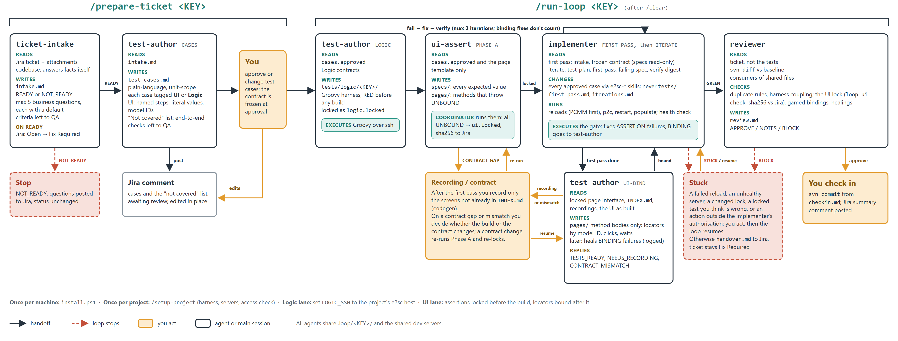

# Agent loop kit (E2open SCPM / SSP projects)

Four Claude Code subagents and three commands that take a Jira ticket from intake to a reviewed change
that you check in to SVN. It runs a code, test and fix loop with a locked definition of done.

## How it works


Orange boxes are where you act; the dashed red lines are where the loop stops. All agents share
`.loop/<KEY>/` and the shared dev servers.

The loop's tests are unit-scope: one screen or element, or one upload, with one action under test.
End-to-end testing is QA's job, after the ticket is Resolved.
## Install (once per machine)
1. You need Claude Code, Node.js (for `node` and `npx`), Git for Windows (Git Bash), Playwright and VPN access to the dev servers.
2. From this folder, run:
   ```powershell
   pwsh -File .\install.ps1
   ```
   - It copies `claude\` into `%USERPROFILE%\.claude`, keeping files you already have (`-Force`
     overwrites them).
   - It registers the lock hook and the SSH guard hook in `settings.json`, backing up the old file first.
   - It self-tests the lock hook and the ui-assert read sandbox.
   - On an existing install it updates the lock hook's matcher (it now includes `Read`) and removes the retired `loop\test-author\tests.md`. Use `-Force` to take the new agents, commands and scripts.
3. Restart Claude Code (new agent types, such as `ui-assert`, are only picked up by a new session).
4. Keep the Jira cookie fresh (`node ~/.claude/scripts/jira-login.js`): the lock's sha256 is posted to Jira and checked against it before review.

## Set up a project (once per project)
Open the project's SVN working copy in Claude Code and run:
```
/setup-project
```
It works through these steps:
1. Checks the kit is installed.
2. Suggests dev servers it finds in the repo, then asks you for:
   - the stack
   - e2sc and e2na hosts
   - your SSH user and key
   - the test login
   - whether tests may drop files into the inbox
   - your Jira keys
3. Checks access, read-only. It never reloads or restarts anything.
4. Creates `e2sc-ui_tests/` from the template and runs a smoke login test.
5. Checks Jira access and asks which transition means "work started".
6. Registers the project in `~/.claude/loop/servers.md`.
7. Writes `.loop/SETUP.md`.


## Work a ticket
| Command | What it does |
|---|---|
| `/prepare-ticket <KEY>` | **ticket-intake** decides READY or NOT_READY (questions go to Jira). **test-author** drafts plain-language test cases, each in the UI or Logic lane, with the contract they rely on (named steps, literal expected values, the model ID of every asserted element). They are posted to Jira. You approve or change them in chat and say what access and data the tests may use. The approved UI cases and contract are frozen into `cases.approved`. No tests are written yet. |
| `/run-loop <KEY>` | Run `/clear` first. **Before the build:** test-author writes the Logic harness (RED, locked as `logic.locked`); **ui-assert** writes the UI specs and an UNBOUND page-object interface from `cases.approved` alone; the coordinator runs them (all must fail with UNBOUND), locks them as `ui.locked` and posts its sha256 to Jira. **Build:** the **implementer** makes the change through the skills. **After the build:** test-author binds the page objects to the built UI (locators only; it may ask you for codegen recordings), then the implementer iterates against the locked tests, up to 3 times. The coordinator re-verifies, **reviewer** checks the change against the ticket and the lock, and you get `checkin.md` plus a Jira summary. The implementer may run the reload scripts, p2c, restarts and populate itself (see "Ground rules"); you commit. |

### Two-phase UI tests
The UI tests can't take their expected values from what was built, so they are written in two phases:
- **Phase A (ui-assert, before the build):** complete Playwright specs in `tests/locked/<KEY>/specs/`, with every expected value from the approved case, and page objects in `pages/` whose methods are named after the case steps and only throw `UNBOUND`. ui-assert can read only `cases.approved` and the page template (the hook enforces it). If the contract is incomplete it replies `CONTRACT_GAP` and you complete it.
- **Phase B (test-author UI-BIND, after the build):** fills in page-object method bodies only (locators by model ID, clicks, navigation, waits). It can't change specs, signatures or anything outside `pages/`, put `expect` in pages, hard-code expected values, or hide a step ("click if present"). A step it can't bind is a `CONTRACT_MISMATCH` for you to decide.
- **Failures** are classified by `loop-ui-check.js --classify`: `ASSERTION` (a defect for the implementer, including a contract model ID that isn't in the DOM), `BINDING` (a locator that doesn't resolve and doesn't use the model ID: test-author fixes it, and after the binding is recorded heals it without asking you, re-binding by the model ID; a second heal of the same method, or more than 3 members, stops for you) and `UNBOUND`.
- **Enforcement:** `loop-ui-check.js` checks the specs, signatures, `expect` counts and every file outside `pages/` against `ui.locked` before every gate run (exit 4 `CHECK:`), and `--jira` compares `ui.locked` with the sha256 posted to Jira (exit 3 = Jira cookie expired, not verified). Only you delete a lock file; the hook blocks every agent and the coordinator from editing or deleting one.
- A contract change goes back to case approval: you delete `ui.locked` (and `ui.bound`), Phase A runs again and is re-locked, and the Logic tests are re-run (rewritten and RED again if a Logic case changed).
- Tickets locked with the older single-phase `tests.locked` keep working as before.

## What's in the kit
| Path under `claude\` | Purpose |
|---|---|
| `agents\` | `ticket-intake`, `test-author`, `ui-assert`, `implementer`, `reviewer` |
| `agents\ui-assert.md` | Phase A of the UI tests: writes the specs and the UNBOUND page-object interface from `cases.approved` alone, with Read and Write only. A new agent type: restart Claude Code after installing |
| `loop\test-author\` | The per-mode procedures `test-author` reads: `cases.md`, `logic.md` and `ui-bind.md` (Phase B binding and healing; replaces the old `tests.md`, which the installer removes). The agent file holds only the shared rules, so each run loads just its own mode |
| `commands\` | `setup-project`, `prepare-ticket`, `run-loop` |
| `hooks\protect-locked-tests.js` | Knows which agent is calling (`agent_type`). Blocks edits to locked tests (`tests.locked`, `logic.locked`, and after `ui.locked` the `specs/`; only test-author may change `pages/`); keeps the implementer out of `e2sc-ui_tests/tests/`; keeps ui-assert to its inputs; blocks every caller from writing or deleting a lock file or `cases.approved` (subagents) by file tool or shell command; lets only the main session run `loop-ui-check.js --lock/--bound/--heal`. Shell matching is best-effort; `loop-ui-check.js` is the real check |
| `scripts\loop-ui-check.js` | Enforcement for the two-phase UI tests: `--lock` (after the UNBOUND run: writes `ui.locked`), the default check (before every gate run), `--classify`, `--bound`, `--heal` and `--jira`. See "Two-phase UI tests" |
| `loop\harness-template\tests\ui-contract.ts`, `tests\locked\_page-template.ts` | The `unbound()` runtime the page objects call, and the page-object and spec shape ui-assert follows (and the check parses) |
| `hooks\loop-ssh-guard.js` | Lets the loop agents SSH to the hosts in your `servers.md` without a prompt (only the implementer may scp outside the inbox). A reload, populate, p2c or restart asks you, whichever agent runs it, **except the implementer**, which may run them. The hook can't tell which project's host the implementer is touching, so it allows any host in your `servers.md`; to withdraw the authorisation, make the hook ask for every agent again |
| `scripts\loop-verify.sh` | The gate: GREEN only if every locked test passes (no retries, no `test.fail`/`skip`/`only`). Prints a short failure digest, also saved as `last-verify-summary.txt`, with the failure classification for two-phase tickets. Runs `loop-ui-check.js` first once `ui.locked` exists (exit 4 `CHECK:`), and refuses specs without a lock. `--ui-only` skips the Logic lane (Phase A's UNBOUND run) |
| `loop\harness-template\tests\logic\_template.logic.groovy` | Template for the Logic lane: test-author writes a Groovy harness for logic cases before the build, locks it as `logic.locked`, and `loop-verify.sh` runs it over ssh first. Set `LOGIC_SSH` to the project's e2sc host from `servers.md` |
| `scripts\loop-check.js` | Mechanical check before locking the Logic harness (`--logic --lock` writes `logic.locked`), and for older single-phase UI tickets (`tests.locked`): every approved case has exactly one test named with its `TC` ID, none for dropped cases, no `test.fail`/`skip`/`fixme`/`only` or fixed delays. Refuses to overwrite a lock. Needs an `Approved case IDs: TC1, TC2` line in `cases.approved` |
| `skills\e2sc-playwright\locked-tests.md` | Short cheat sheet test-author reads instead of the full skill and guide when binding page objects: helper imports, `startWorkflow`, one fresh page and login per test, control reading, downloads, uploads and speed tips |
| `loop\harness-template\recordings\INDEX.md` | Library of recorded flows. test-author checks it before asking for a recording and adds a row when it uses or adds one, so each screen is recorded once |
| `scripts\jira.js` | Reads, comments on, edits comments on, transitions and creates (`meta`, `create`, `link`) Jira tickets through the SSO browser cookie (`~/.jira-cookie`) |
| `scripts\jira-login.js` | Refreshes `~/.jira-cookie`: signs in through Entra in a visible browser (prompts for the SSO password, you type the SMS/MFA code), checks the cookie against Jira, then saves it. Needs Playwright (`e2sc-ui_tests/node_modules`). Run `node ~/.claude/scripts/jira-login.js --user <sso-login>` |
| `scripts\loop-record.js` | Records a UI flow for test-author: launches Playwright codegen with the project's base URL, prints the steps that were requested, never overwrites an earlier recording, and checks the result (has an assertion, ends on the result screen, login types a username). `--check` re-checks a recording; `--dry-run` shows the command. Run `node ~/.claude/scripts/loop-record.js <KEY> <flow>` from the project root |
| `loop\servers.md` | Per-project hosts and the shared-server rules (reloads, populate, p2c and restarts need a human, except when the implementer runs them) |
| `loop\always-human.md` | Areas the loop never changes without a Jira approval. **Review it for your client.** |
| `loop\harness-template\` | The Playwright harness `/setup-project` copies into a project |
| `skills\` | The e2sc/e2na config skills the implementer uses |

## Ground rules
- The loop never commits and never moves a ticket past the start transition. You do both.
- Every dev server is shared. The implementer may run the reload scripts, p2c and restarts, and populate
  only after a clean PCMM reload. It backs up first, checks the server's health afterwards, and restores
  and stops if the PCMM reload fails or the server is unhealthy. Every other agent, and you via the main
  session, are asked first. Read `loop\servers.md` rule 1 before you install: it applies to every host in
  your `servers.md`.
- Don't commit `.loop/`, `node_modules/`, `test-results/`, `playwright-report/`, `recordings/`, or any
  cookie or password file.

## Updating the kit
Edit the files here, then have everyone run `install.ps1 -Force`. Your `servers.md` (your projects)
and `always-human.md` (your client rules) are never overwritten, even with `-Force`. To pick up new
shared rules in those two, compare them with the kit copies by hand.
