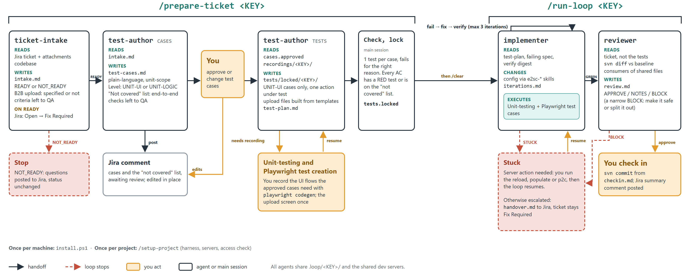

# Agent loop kit (E2open SCPM / SSP projects)

Four Claude Code subagents and three commands that take a Jira ticket from intake to a reviewed change
that you check in to SVN. It runs a code, test and fix loop with a locked definition of done.

## How it works


Orange boxes are where you act; the dashed red lines are where the loop stops. All agents share
`.loop/<KEY>/` and the shared dev servers.

The loop's tests are unit-scope: one screen or element, or one upload, with one action under test.
End-to-end testing is QA's job, after the ticket is Resolved.
## Install (once per machine)
1. You need Claude Code, Node.js (for `node` and `npx`), Git for Windows (Git Bash), Playwright and VPN access to the dev servers.
2. From this folder, run:
   ```powershell
   pwsh -File .\install.ps1
   ```
   - It copies `claude\` into `%USERPROFILE%\.claude`, keeping files you already have (`-Force`
     overwrites them).
   - It registers the lock hook and the SSH guard hook in `settings.json`, backing up the old file first.
   - It self-tests the lock hook.
3. Restart Claude Code.

## Set up a project (once per project)
Open the project's SVN working copy in Claude Code and run:
```
/setup-project
```
It works through these steps:
1. Checks the kit is installed.
2. Suggests dev servers it finds in the repo, then asks you for:
   - the stack
   - e2sc and e2na hosts
   - your SSH user and key
   - the test login
   - whether tests may drop files into the inbox
   - your Jira keys
3. Checks access, read-only. It never reloads or restarts anything.
4. Creates `e2sc-ui_tests/` from the template and runs a smoke login test.
5. Checks Jira access and asks which transition means "work started".
6. Registers the project in `~/.claude/loop/servers.md`.
7. Writes `.loop/SETUP.md`.


## Work a ticket
| Command | What it does |
|---|---|
| `/prepare-ticket <KEY>` | **ticket-intake** decides READY or NOT_READY (questions go to Jira). **test-author** drafts plain-language test cases, which are posted to Jira. You approve or change them in chat and say what access and data the tests may use. test-author then asks you to record the codegen flows those cases need and writes exactly the approved cases as Playwright tests. The coordinator checks one test per case and that each fails for the right reason, then locks them. You don't review the test code. |
| `/run-loop <KEY>` | Run `/clear` first. Checks the lock, then **implementer** changes config through the skills and runs the gate, up to 3 times. The coordinator re-verifies, **reviewer** checks the change against the ticket, and you get `checkin.md` plus a Jira summary. The implementer may run the reload scripts, p2c, restarts and populate itself (see "Ground rules"); you commit. |

## What's in the kit
| Path under `claude\` | Purpose |
|---|---|
| `agents\` | `ticket-intake`, `test-author`, `implementer`, `reviewer` |
| `loop\test-author\` | The per-mode procedures `test-author` reads: `cases.md`, `logic.md` and `tests.md`. The agent file holds only the shared rules, so each run loads just its own mode |
| `commands\` | `setup-project`, `prepare-ticket`, `run-loop` |
| `hooks\protect-locked-tests.js` | Blocks edits to `tests/locked/<KEY>/` once `.loop/<KEY>/tests.locked` exists |
| `hooks\loop-ssh-guard.js` | Lets the loop agents SSH to the hosts in your `servers.md` without a prompt (only the implementer may scp outside the inbox). A reload, populate, p2c or restart asks you, whichever agent runs it, **except the implementer**, which may run them. The hook can't tell which project's host the implementer is touching, so it allows any host in your `servers.md`; to withdraw the authorisation, make the hook ask for every agent again |
| `scripts\loop-verify.sh` | The gate: GREEN only if every locked test passes (no retries, no `test.fail`/`skip`/`only`). Prints a short failure digest, also saved as `last-verify-summary.txt` |
| `loop\harness-template\tests\logic\_template.logic.groovy` | Template for the Logic lane: test-author writes a Groovy harness for logic cases before the build, locks it as `logic.locked`, and `loop-verify.sh` runs it over ssh first. Set `LOGIC_SSH` to the project's e2sc host from `servers.md` |
| `scripts\loop-check.js` | Mechanical check before locking: every approved case has exactly one test named with its `TC` ID, none for dropped cases, no `test.fail`/`skip`/`fixme`/`only` or fixed delays. `--lock` writes `tests.locked` with hashes, and refuses to overwrite one that already exists. Needs an `Approved case IDs: TC1, TC2` line in `cases.approved` |
| `skills\e2sc-playwright\locked-tests.md` | Short cheat sheet test-author reads instead of the full skill and guide when writing locked tests: helper imports, `startWorkflow`, one fresh page and login per test (no shared page, no serial mode), control reading, downloads, uploads, test shape and speed tips |
| `loop\harness-template\recordings\INDEX.md` | Library of recorded flows. test-author checks it before asking for a recording and adds a row when it uses or adds one, so each screen is recorded once |
| `scripts\jira.js` | Reads, comments on, edits comments on, transitions and creates (`meta`, `create`, `link`) Jira tickets through the SSO browser cookie (`~/.jira-cookie`) |
| `scripts\jira-login.js` | Refreshes `~/.jira-cookie`: signs in through Entra in a visible browser (prompts for the SSO password, you type the SMS/MFA code), checks the cookie against Jira, then saves it. Needs Playwright (`e2sc-ui_tests/node_modules`). Run `node ~/.claude/scripts/jira-login.js --user <sso-login>` |
| `scripts\loop-record.js` | Records a UI flow for test-author: launches Playwright codegen with the project's base URL, prints the steps that were requested, never overwrites an earlier recording, and checks the result (has an assertion, ends on the result screen, login types a username). `--check` re-checks a recording; `--dry-run` shows the command. Run `node ~/.claude/scripts/loop-record.js <KEY> <flow>` from the project root |
| `loop\servers.md` | Per-project hosts and the shared-server rules (reloads, populate, p2c and restarts need a human, except when the implementer runs them) |
| `loop\always-human.md` | Areas the loop never changes without a Jira approval. **Review it for your client.** |
| `loop\harness-template\` | The Playwright harness `/setup-project` copies into a project |
| `skills\` | The e2sc/e2na config skills the implementer uses |

## Ground rules
- The loop never commits and never moves a ticket past the start transition. You do both.
- Every dev server is shared. The implementer may run the reload scripts, p2c and restarts, and populate
  only after a clean PCMM reload. It backs up first, checks the server's health afterwards, and restores
  and stops if the PCMM reload fails or the server is unhealthy. Every other agent, and you via the main
  session, are asked first. Read `loop\servers.md` rule 1 before you install: it applies to every host in
  your `servers.md`.
- Don't commit `.loop/`, `node_modules/`, `test-results/`, `playwright-report/`, `recordings/`, or any
  cookie or password file.

## Updating the kit
Edit the files here, then have everyone run `install.ps1 -Force`. Your `servers.md` (your projects)
and `always-human.md` (your client rules) are never overwritten, even with `-Force`. To pick up new
shared rules in those two, compare them with the kit copies by hand.
