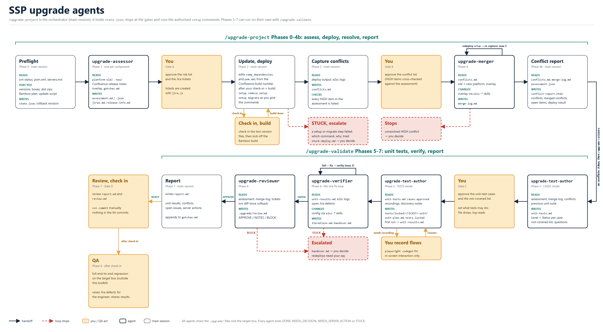

# SSP upgrade kit

Claude Code commands and agents for upgrading an E2open SSP customer overlay project to a new platform drop. Generic across customers.

## Install
Install the agent-loop kit first (it provides `/setup-project`, `loop-verify.sh`, the `e2sc-ui_tests` harness template, `servers.md`, `loop-record.js`, the e2sc-playwright skill's `locked-tests.md`, and the `test-author` files that `upgrade-test-author` reads: `agents/test-author.md` for the rules and `loop/test-author/tests.md` for the upload cases and harness lessons; `install.ps1` warns about any that are missing), then:

    powershell -File install.ps1            # installs into ~/.claude
    powershell -File install.ps1 -Dest X    # test install elsewhere

Phase 1 reads the release notes on Confluence with `node ~/.claude/scripts/confluence.js` (installed by this kit, read-only). It needs `~/.confluence-cookie`, an SSO session cookie kept the same way as `~/.jira-cookie`.

## Use
Open Claude Code in the project (SVN working copy) and run `/upgrade-project`. It is resumable via `.upgrade/state.json`.

Phases 5-7 (unit tests, verify, report) can also be run on their own with `/upgrade-validate`, ideally in a fresh session after `/clear`; `/upgrade-project resume` then picks up again for Phase 8.

Roles: the **engineer** runs the upgrade and owns Gates A, B, C and D (D: review the report, then check in with SVN); **QA** runs the full end-to-end regression outside this toolkit after the check-in, raises Jira defects for the engineer and shares the test results.

Flow: preflight (versions, SVN rollback point, target box, dist zip locations) -> platform trees from the dist zips and assessment per component with Jira tickets [Gate A; read-only, before any server action] -> update and deploy (the orchestrator edits `comp_dependencies` and `pom.xml` from the Confluence build number, you check in the two files and kick off the Bamboo build, then `setup remove`, `setup` and the `setup migrate` commands you give it; a failed step stops as STUCK) -> capture conflicts from the deployment [Gate B] -> resolve conflicts, redeploy with plain `setup` (max 3 rounds) -> HTML conflict report to share -> Playwright unit tests of HIGH-risk items and basic upload/download flows, every upgrade [Gate C] -> verify and fix (max 3 iterations) -> independent review -> report -> you review the report and check in [Gate D] -> QA end-to-end regression (the last step). Redeploys are capped at 5 overall. Nothing commits: you check in with SVN.

Every subagent ends with DONE, NEEDS_DECISION, NEEDS_SERVER_ACTION or STUCK; `upgrade-test-author` also returns CASES_READY, NEEDS_RECORDING, NEEDS_DISCOVERY and CONTRACT_MISMATCH. Assessor, merger and verifier read `~/.claude/upgrade/gotchas.md` first.

## Phases
| # | Phase | Owner | What happens | Output | Stop |
|---|-------|-------|--------------|--------|------|
| 0 | Preflight | Engineer | Check the project is in `servers.md`, `svn status` is clean, record the rollback revision. Confirm current/target/base SSP versions, the target box, dist zip locations, the previous unit suite, deploy authorisation, Jira project, names. Check SSH to the target box. | `state.json` | Any answer fails validation |
| 1 | Platform trees and assessment | Engineer | Extract the old and new platform trees from the dist zips (read-only), and read the target release's notes on Confluence (build number, dates, scope) into `release-info.md` and the assessment's Release build section. One `upgrade-assessor` per component ranks every customisation HIGH/MEDIUM/LOW against the platform delta and drafts Jira tickets under `.upgrade/assessment/<component>/`; the orchestrator merges them and composes the parent ticket. Approved drafts become tickets. The approved assessment is shared with QA. | `platform-old/`, `platform-new/`, `release-info.md`, `assessment.md`, `assessment.json`, `jiras.md`, tickets | **Gate A** |
| 2 | Update, build, deploy | Engineer | The orchestrator edits `comp_dependencies` and `pom.xml` to the build from the Confluence release notes (approved at Gate A), then waits while you check in those two files and kick off the Bamboo build. It then runs `setup remove` and `setup`, and the `setup migrate` commands you give it during the setup, each exactly as given. A failing step stops as **STUCK**: the command, why it failed, what was tried and the options go to you in `stuck-deploy.md`. Then re-seed data and run the smoke check. | Edited version files, `stuck-deploy.md` if stuck, deployed box | STUCK on a failed step; the Bamboo build |
| 3 | Capture conflicts | Engineer | Run any extra p2c/reload/restart steps. Collect the conflicts the deployment reported, tag each with risk and ticket. Cross-check every HIGH assessment item is listed or marked "no action". | `conflicts.md` | **Gate B** |
| 4 | Resolve | Engineer | `upgrade-merger` resolves each conflict (`*.replace` starts from the new platform file and re-applies the customer delta). Redeploy with plain `setup`, re-capture, smoke check. Up to 3 rounds, within the 5-redeploy cap. | `merge-log.md`, updated `conflicts.md` | Unresolved HIGH conflict |
| 4b | Conflict report | Engineer | After the final successful redeploy (smoke check clean), the orchestrator writes `conflict-report.html`: one self-contained HTML file with summary counts by risk, a table of the conflicts, a table of the merged conflicts (how each was resolved and which sides were kept), anything still open, and the deployment and smoke-check result. On your say it is attached to the parent ticket or sent to QA; the kit never publishes it. | `conflict-report.html` | Ready to share |
| 5 | Playwright unit tests (every upgrade) | Engineer | Validates the build, and starts only after the conflicts are resolved. `upgrade-test-author` drafts `.upgrade/unit-tests.md` from the final assessment and merge log (a case for each HIGH-risk item as the merge left it, one basic case per upload/download workflow, trimmed to the smallest set; carried forward from the previous upgrade's suite where one exists). The engineer approves the cases, then `upgrade-test-author` writes the Playwright tests (recordings by the engineer for in-screen interaction; read-only discovery runs for open-and-check screens), and the first run of `loop-verify.sh <TICKET>-unit` on the target box is recorded. Failures are not fixed here. Narrow by design: QA's full end-to-end regression is separate and outside this toolkit. | `unit-tests.md`, `unit-results.md`, `tests/locked/<TICKET>-unit/` | **Gate C** |
| 6 | Verify and fix | Engineer | `upgrade-verifier` owns the single fix loop (3 iterations before the check-in, and 3 more for QA defects after it): it works the unit failures and open Jira defects, batches its product/config fixes, reads server logs, and sends merge mistakes back to `upgrade-merger`, until the unit gate is GREEN. Server actions come back as NEEDS_SERVER_ACTION. Then `upgrade-reviewer` checks the whole upgrade against the assessment and merge log. | `iterations.md`, `handover.md`, `review.md` | STUCK, or a BLOCK |
| 7 | Report | Engineer | Summarise versions, files by overlay type, conflicts auto vs human resolved, unit test results, open issues, server actions, redeploy count, rollback revision. Append new gotchas. The engineer then reviews `report.md` and `review.md` and checks in with SVN manually; nothing in the kit commits. | `report.md`, `gotchas.md` | **Gate D** |
| 8 | QA end-to-end regression (after the check-in) | QA | QA runs the full end-to-end regression on the upgraded target box outside this toolkit, raises a Jira defect for each failure (assigned to the engineer) and shares the test results. The engineer gives the orchestrator the results location and the open defect keys; defects are fixed in Phase 6 or 4, the fixes are checked in as a follow-up, and QA retests. Done when results are shared and no open defects remain (or the engineer accepts them in writing). | Results reference and defect list in `report.md` | The last step |

## Agents
`/upgrade-project` is the orchestrator: it runs in the main Claude Code session, holds `.upgrade/state.json`, stops at the gates, runs the authorised `setup` commands and delegates the work below. Every subagent ends with DONE, NEEDS_DECISION, NEEDS_SERVER_ACTION or STUCK, and never runs server actions itself.

Editable source: `docs/upgrade-agents.svg`.

| Agent | Phase | What it does |
|-------|-------|--------------|
| `upgrade-assessor` | 1 | Read-only on the project; writes under `.upgrade/assessment/<component>/`, one agent per component with ids prefixed by component; the orchestrator merges the results. Compares the old and new platform against every customisation, ranks risk HIGH/MEDIUM/LOW, drafts the Jira tickets, and writes `assessment.json`. |
| `upgrade-merger` | 4 | Resolves the conflicts the deployment reported, in the working copy, using the old platform, new platform and customer versions (`*.replace` files start from the new platform file). Uses the config skills, logs every decision in `merge-log.md`, and returns NEEDS_SERVER_ACTION where a server compile is needed. |
| `upgrade-verifier` | 6 | Owns the single fix loop (3 iterations before the check-in, 3 more for QA defects after it). Runs the unit gate on the target box, reads the server logs, classifies each failure, batches product and config fixes through the config skills, and hands merge mistakes back to the merger. Works any open Jira defects assigned to the engineer. Never edits locked tests. |
| `upgrade-test-author` | 5 | After the merge, drafts the unit-test cases (CASES mode: a Level and a Status per case, trimmed to the smallest set, with a not-covered list and questions). Then writes the Playwright tests for the engineer-approved cases (TESTS mode: UNIT-UI only; logic-unit and end-to-end are listed as not written). Tests are expected to pass on the upgraded box. Every case carries a discriminating check and a confirmed menu path; locked tests start screens with `startWF` rather than clicking the menu, and a screen that differs from the approved case returns CONTRACT_MISMATCH instead of being worked around. It uses the harness menu map to name each screen's menu path, reuses recordings from `recordings/INDEX.md`, asks the engineer for codegen recordings only for in-screen interaction (selecting values, uploads, downloads), and uses read-only discovery runs for screens that are only opened and checked. Separate from the agent loop's `test-author`; it reuses that file's harness lessons and upload rules. |
| `upgrade-reviewer` | 6 | Independent review of the whole upgrade against the assessment, merge log and tickets (not the tests): every HIGH item handled, `*.replace` files built from the new platform file, spec versions and source spreadsheets, locked test hashes, scope creep and commit hygiene. Separate from the agent loop's `reviewer`. Writes `review.md`. It also reviews the follow-up fixes for QA defects after the check-in. |

The agents use these skills for config changes and checks: `e2sc-config`, `e2sc-ocmm`, `e2sc-pcmm`, `e2sc-io`, `e2sc-cfg`, `alert-config`, `e2na-config`, `e2sc-logging` and `e2sc-playwright`.

## Safety
- You are asked at preflight whether agents may run `setup remove` / `setup` on the dedicated upgrade box, and the `setup migrate` commands you give it during the setup. `setup remove` and the migrate commands are used for the first deployment only. Reloads, p2c, restarts and inbox drops always stay with you.
- Locked tests are never edited to pass.
- Platform lessons go in `~/.claude/upgrade/gotchas.md` (kept on reinstall). Keep customer names and hosts out of it.

## Contents
- `claude/commands/upgrade-project.md` - orchestrator
- `claude/commands/upgrade-validate.md` - Phases 5-7: unit tests, verify and fix, report
- `claude/scripts/confluence.js` - read-only Confluence client (release notes, build number)
- `claude/agents/upgrade-assessor.md`, `upgrade-merger.md`, `upgrade-reviewer.md`, `upgrade-test-author.md`, `upgrade-verifier.md`
- `docs/upgrade-agents.png`, `upgrade-agents.svg` - agent and phase diagram
- `claude/upgrade/gotchas.md`
