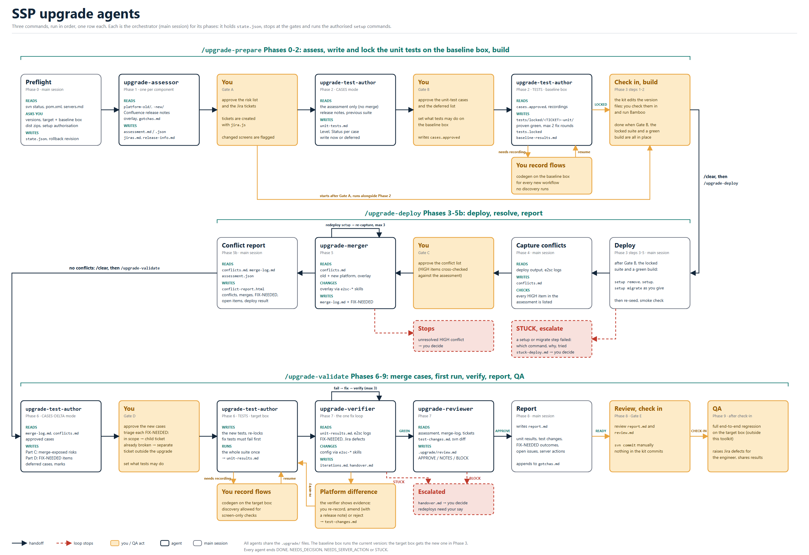

# SSP upgrade kit

Claude Code commands and agents for upgrading an E2open SSP customer overlay project to a new platform drop. Generic across customers.

## Install
Install the agent-loop kit first (it provides `/setup-project`, `loop-verify.sh`, the `e2sc-ui_tests` harness template, `servers.md`, `loop-record.js`, the e2sc-playwright skill's `locked-tests.md`, and the `test-author` files that `upgrade-test-author` reads: `agents/test-author.md` for the rules and `loop/test-author/tests.md` for the upload cases and harness lessons; `install.ps1` warns about any that are missing), then:

    powershell -File install.ps1            # installs into ~/.claude
    powershell -File install.ps1 -Dest X    # test install elsewhere

Phase 1 reads the release notes on Confluence with `node ~/.claude/scripts/confluence.js` (installed by this kit, read-only). It needs `~/.confluence-cookie`, an SSO session cookie kept the same way as `~/.jira-cookie`.

## Use
Open Claude Code in the project (SVN working copy) and run `/upgrade-project`. It is resumable via `.upgrade/state.json`.

Phases 6-8 (merge cases and first run on the upgraded box, verify, report) can also be run on their own with `/upgrade-validate`, ideally in a fresh session after `/clear`; `/upgrade-project resume` then picks up again for Phase 9.

Roles: the **engineer** runs the upgrade and owns Gates A to E (A: assessment, B: unit-test cases before the deploy, C: conflict list, D: cases the merge added, E: review the report, then check in with SVN); **QA** runs the full end-to-end regression outside this toolkit after the check-in, raises Jira defects for the engineer and shares the test results.

Two boxes: the **target box** is the dedicated upgrade box, empty until Phase 3 deploys the new version. The **baseline box** is a separate, unshared box on the current version: the unit tests are recorded, written and proven there in Phase 2, before anything is deployed or merged, so the merge can't shape what is tested. The upgrade is expected to be as-is, so the same tests should pass on the target box.

Flow: preflight (versions, SVN rollback point, target box, baseline box, dist zip locations) -> platform trees from the dist zips and assessment per component with Jira tickets [Gate A; read-only, before any server action] -> unit-test cases from the assessment only [Gate B], then Playwright tests from your codegen recordings on the baseline box (no discovery), proven green and locked; runs while you wait for the check-in and Bamboo build -> update and deploy (the orchestrator edits `comp_dependencies` and `pom.xml` from the Confluence build number, you check in the two files and kick off the Bamboo build, then, once the suite is locked, `setup remove`, `setup` and the `setup migrate` commands you give it; a failed step stops as STUCK) -> capture conflicts from the deployment [Gate C] -> resolve conflicts, redeploy with plain `setup` (max 3 rounds); other scenarios the merger finds are logged as FIX-NEEDED -> HTML conflict report to share -> cases for merge-exposed risks, deferred cases and FIX-NEEDED triage [Gate D], tests for them on the target box (red first for a fix not yet made), first run of the whole suite -> verify and fix (max 3 iterations; a platform difference on one case can re-enter Phase 2 with your approval) -> independent review -> report -> you review the report and check in [Gate E] -> QA end-to-end regression (the last step). Redeploys are capped at 5 overall. Nothing commits: you check in with SVN.

Every subagent ends with DONE, NEEDS_DECISION, NEEDS_SERVER_ACTION or STUCK; `upgrade-test-author` also returns CASES_READY, NEEDS_RECORDING, NEEDS_DISCOVERY and CONTRACT_MISMATCH. Assessor, merger and verifier read `~/.claude/upgrade/gotchas.md` first.

## Phases
| # | Phase | Owner | What happens | Output | Stop |
|---|-------|-------|--------------|--------|------|
| 0 | Preflight | Engineer | Check the project is in `servers.md`, `svn status` is clean, record the rollback revision. Confirm current/target/base SSP versions, the target box, the baseline box (current version, not shared, what tests may do there), dist zip locations, the previous unit suite, deploy authorisation, Jira project, names. Check SSH to both boxes. | `state.json` | Any answer fails validation |
| 1 | Platform trees and assessment | Engineer | Extract the old and new platform trees from the dist zips (read-only), and read the target release's notes on Confluence (build number, dates, scope) into `release-info.md` and the assessment's Release build section. One `upgrade-assessor` per component ranks every customisation HIGH/MEDIUM/LOW against the platform delta and drafts Jira tickets under `.upgrade/assessment/<component>/`; the orchestrator merges them and composes the parent ticket. Approved drafts become tickets. Items whose screen or behaviour the new platform changes are flagged: their tests are deferred to Phase 6. The approved assessment is shared with QA. | `platform-old/`, `platform-new/`, `release-info.md`, `assessment.md`, `assessment.json`, `jiras.md`, tickets | **Gate A** |
| 2 | Unit cases and tests on the baseline box (every upgrade) | Engineer | `upgrade-test-author` drafts `.upgrade/unit-tests.md` from the assessment only (a case for each HIGH-risk item, one basic case per upload/download workflow, trimmed to the smallest set, carried forward from the previous suite; each `write now` or `deferred`). After you approve the cases, it writes the Playwright tests on the baseline box: it reuses existing recordings and asks you for a codegen recording of every new workflow (no discovery runs), fixes test defects (max 2 rounds) until the suite is green, and the suite is locked. Runs while you wait for the check-in and Bamboo build in Phase 3. Narrow by design: QA's full end-to-end regression is separate. | `unit-tests.md`, `cases.approved`, `tests/locked/<TICKET>-unit/`, `tests.locked`, `baseline-results.md` | **Gate B**; the deploy waits for the lock |
| 3 | Update, build, deploy | Engineer | The orchestrator edits `comp_dependencies` and `pom.xml` to the build from the Confluence release notes (approved at Gate A), then waits while you check in those two files and kick off the Bamboo build. Once the Phase 2 suite is locked it runs `setup remove` and `setup`, and the `setup migrate` commands you give it during the setup, each exactly as given. A failing step stops as **STUCK**: the command, why it failed, what was tried and the options go to you in `stuck-deploy.md`. Then re-seed data and run the smoke check. | Edited version files, `stuck-deploy.md` if stuck, deployed box | STUCK on a failed step; the Bamboo build |
| 4 | Capture conflicts | Engineer | Run any extra p2c/reload/restart steps. Collect the conflicts the deployment reported, tag each with risk and ticket. Cross-check every HIGH assessment item is listed or marked "no action". | `conflicts.md` | **Gate C** |
| 5 | Resolve | Engineer | `upgrade-merger` resolves each conflict (`*.replace` starts from the new platform file and re-applies the customer delta). Any other scenario it finds that should be fixed is logged as FIX-NEEDED, not fixed. Redeploy with plain `setup`, re-capture, smoke check. Up to 3 rounds, within the 5-redeploy cap. | `merge-log.md` (with FIX-NEEDED), updated `conflicts.md` | Unresolved HIGH conflict |
| 5b | Conflict report | Engineer | After the final successful redeploy (smoke check clean), the orchestrator writes `conflict-report.html`: one self-contained HTML file with summary counts by risk, a table of the conflicts, a table of the merged conflicts (how each was resolved and which sides were kept), the FIX-NEEDED items, anything still open, and the deployment and smoke-check result. On your say it is attached to the parent ticket or sent to QA; the kit never publishes it. | `conflict-report.html` | Ready to share |
| 6 | Merge cases and first run on the target box | Engineer | `upgrade-test-author` adds cases for conflicts you decided and merges marked uncertain, the deferred cases, and one per FIX-NEEDED item, and marks approved cases the merge affected. You approve them and triage each FIX-NEEDED item: in scope (caused by the upgrade) gets a child ticket and a test that must fail before its fix; already broken gets a separate ticket outside the upgrade. The new tests are written on the target box, the suite is re-locked, and the whole suite runs once there. Failures are not fixed here. | `unit-tests.md` (Parts C, D), `unit-results.md`, updated `tests.locked` | **Gate D** |
| 7 | Verify and fix | Engineer | `upgrade-verifier` owns the single fix loop (3 iterations before the check-in, and 3 more for QA defects after it): it works the unit failures, in-scope FIX-NEEDED items and open Jira defects, batches its product/config fixes, reads server logs, and sends merge mistakes back to `upgrade-merger`, until the unit gate is GREEN. A test that passed on the baseline box but fails because the new platform shows the same behaviour differently is a platform difference: you decide per case to re-record it, amend it (with a release-note source) or reject it as a regression; changes are logged in `test-changes.md` (more than 3 re-entered cases stops the loop). Server actions come back as NEEDS_SERVER_ACTION. Then `upgrade-reviewer` checks the whole upgrade against the assessment and merge log, including the test changes. | `iterations.md`, `handover.md`, `test-changes.md`, `review.md` | STUCK, or a BLOCK |
| 8 | Report | Engineer | Summarise versions, files by overlay type, conflicts auto vs human resolved, unit test results (baseline and target), test changes, FIX-NEEDED outcomes, open issues, server actions, redeploy count, rollback revision. Append new gotchas. The engineer then reviews `report.md` and `review.md` and checks in with SVN manually; nothing in the kit commits. | `report.md`, `gotchas.md` | **Gate E** |
| 9 | QA end-to-end regression (after the check-in) | QA | QA runs the full end-to-end regression on the upgraded target box outside this toolkit, raises a Jira defect for each failure (assigned to the engineer) and shares the test results. The engineer gives the orchestrator the results location and the open defect keys; defects are fixed in Phase 7 or 5, the fixes are checked in as a follow-up, and QA retests. Done when results are shared and no open defects remain (or the engineer accepts them in writing). | Results reference and defect list in `report.md` | The last step |

## Agents
`/upgrade-project` is the orchestrator: it runs in the main Claude Code session, holds `.upgrade/state.json`, stops at the gates, runs the authorised `setup` commands and delegates the work below. Every subagent ends with DONE, NEEDS_DECISION, NEEDS_SERVER_ACTION or STUCK, and never runs server actions itself.

Editable source: `docs/upgrade-agents.svg`.

| Agent | Phase | What it does |
|-------|-------|--------------|
| `upgrade-assessor` | 1 | Read-only on the project; writes under `.upgrade/assessment/<component>/`, one agent per component with ids prefixed by component; the orchestrator merges the results. Compares the old and new platform against every customisation, ranks risk HIGH/MEDIUM/LOW, drafts the Jira tickets, and writes `assessment.json`. |
| `upgrade-test-author` | 2, 6, 7 | CASES mode (Phase 2): drafts the unit-test cases from the assessment only (a Level, Status and Timing per case, trimmed to the smallest set, with a not-covered list and questions). CASES-DELTA mode (Phase 6): adds cases for what the merge exposed and the FIX-NEEDED items, and marks approved cases the merge affected without dropping any. TESTS mode: writes the Playwright tests for an approved case set on a given box. On the baseline box it works from recordings only: it reuses `recordings/INDEX.md` and asks you for a codegen recording of every new workflow. On the target box (Phase 6, and one case at a time on a re-entry in Phase 7) read-only discovery is allowed for screens that are only opened and checked, and tests for a fix not yet made must fail first. Tests create their own data. Every case carries a discriminating check and a confirmed menu path; locked tests start screens with `startWF` rather than clicking the menu, and a screen that differs from the approved case returns CONTRACT_MISMATCH. Separate from the agent loop's `test-author`; it reuses that file's harness lessons and upload rules. |
| `upgrade-merger` | 5 | Resolves the conflicts the deployment reported, in the working copy, using the old platform, new platform and customer versions (`*.replace` files start from the new platform file). Uses the config skills, logs every decision in `merge-log.md`, logs any other scenario that needs fixing as FIX-NEEDED instead of fixing it, and returns NEEDS_SERVER_ACTION where a server compile is needed. |
| `upgrade-verifier` | 7 | Owns the single fix loop (3 iterations before the check-in, 3 more for QA defects after it). Runs the unit gate on the target box, reads the server logs, classifies each failure, batches product and config fixes through the config skills (including the in-scope FIX-NEEDED items), hands merge mistakes back to the merger, and reports platform differences with evidence for you to decide. Works any open Jira defects assigned to the engineer. Never edits locked tests. |
| `upgrade-reviewer` | 7 | Independent review of the whole upgrade against the assessment, merge log and tickets (not the tests): every HIGH item handled, `*.replace` files built from the new platform file, spec versions and source spreadsheets, locked test hashes and every test change against its approval and source, red-first evidence for fixes, scope creep (including fixes triaged out of scope) and commit hygiene. Separate from the agent loop's `reviewer`. Writes `review.md`. It also reviews the follow-up fixes for QA defects after the check-in. |

The agents use these skills for config changes and checks: `e2sc-config`, `e2sc-ocmm`, `e2sc-pcmm`, `e2sc-io`, `e2sc-cfg`, `alert-config`, `e2na-config`, `e2sc-logging` and `e2sc-playwright`.

## Safety
- You are asked at preflight whether agents may run `setup remove` / `setup` on the dedicated upgrade box, and the `setup migrate` commands you give it during the setup. `setup remove` and the migrate commands are used for the first deployment only. Reloads, p2c, restarts and inbox drops always stay with you.
- The unit tests are written and locked on the baseline box before the deploy. Locked tests are never edited to pass: a test changes only through a re-entry you approve, logged in `test-changes.md` and checked by the reviewer.
- Tests may create data and drop inbox files on the baseline box (not shared); on the target box they do only what you allow at Gate D.
- Platform lessons go in `~/.claude/upgrade/gotchas.md` (kept on reinstall). Keep customer names and hosts out of it.

## Contents
- `claude/commands/upgrade-project.md` - orchestrator
- `claude/commands/upgrade-validate.md` - Phases 6-8: merge cases and first run on the upgraded box, verify and fix, report
- `claude/scripts/confluence.js` - read-only Confluence client (release notes, build number)
- `claude/agents/upgrade-assessor.md`, `upgrade-merger.md`, `upgrade-reviewer.md`, `upgrade-test-author.md`, `upgrade-verifier.md`
- `docs/upgrade-agents.png`, `upgrade-agents.svg` - agent and phase diagram
- `claude/upgrade/gotchas.md`
